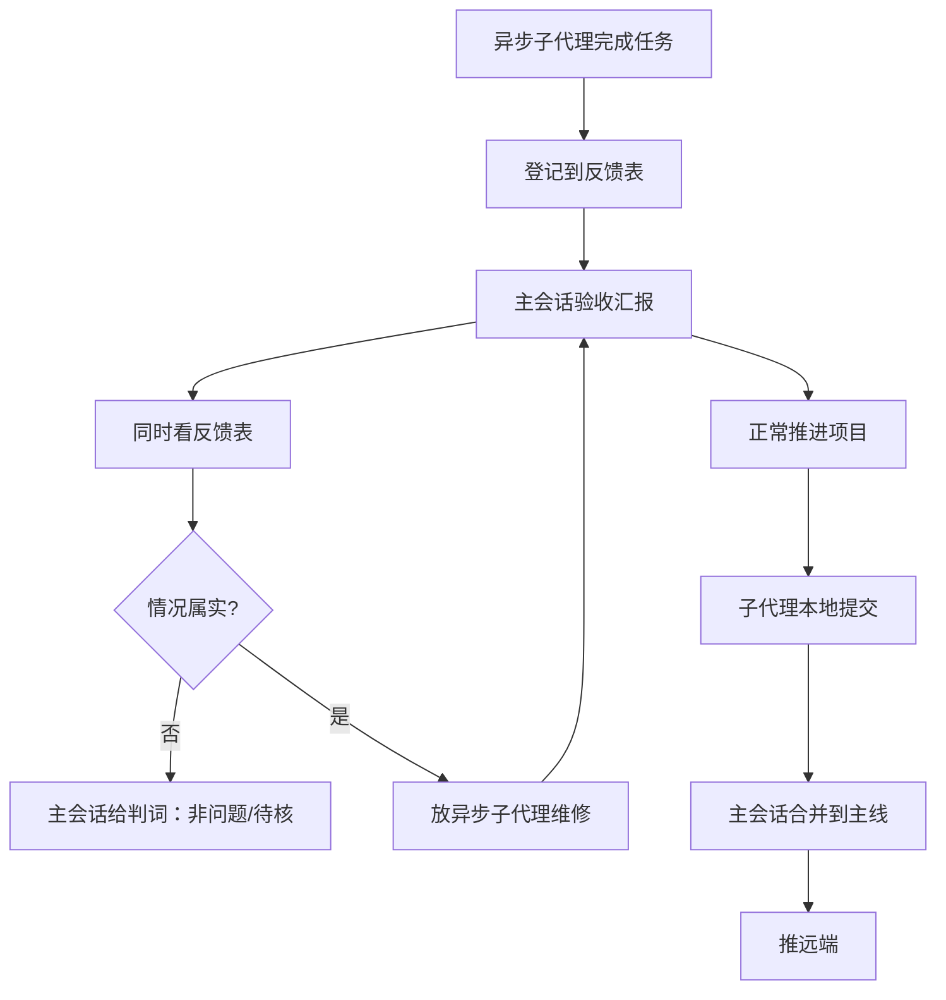

# 完整闭环（临时）

## 闭环



## 五步

```text
1. 子代理完成任务 → 登记信息到反馈表
2. 主会话验收汇报 → 正常推进项目，同时看反馈表
3. 主会话直接查询，核实是否属实
4. 属实 → 直接放异步子代理维修
5. 正常/小任务：子代理提交本地 → 主会话合主线 → 推远端
```

## 边界

```text
反馈表：唯一入口；判词由主会话给，不让提交方自判
维修回来：仍从第 1 步登记反馈
合并与推远端：由主会话做
未完成：保留现场，不清理
已完成：立即清理任务过程记录，保留代码/Git/正式规则
```
