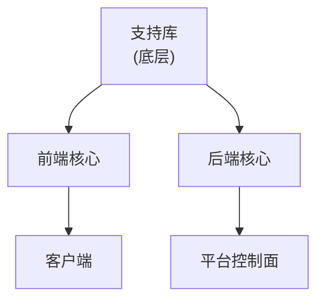

# 任务书 03：依赖关系扫描

**接收agent**：zcode  
**优先级**：P1（不急，但要在批量接入前完成）  
**预计耗时**：1小时  
**并行槽位**：旁路任务，不依赖主线

---

## 一、任务目标

扫描老项目模块间的依赖关系，画出依赖图，确定翻译接入顺序（无依赖的先接，有依赖的后接）。

**产出物**：
- `构建装配/翻译器/老项目依赖图.json`（机器可读）
- `构建装配/翻译器/老项目依赖图.md`（人类可读，带可视化）

---

## 二、输入资料

### 老项目位置
```
/Users/hekunhua/Documents/Agent/PHP/系统工程平台/
```

**注意**：这是V1的前身项目（系统工程平台/），不是生产环境的华世王镞

### 依赖关系来源
扫描老项目目录内的Python/配置文件，提取：
- `import` 语句（直接依赖）
- 配置文件中的依赖声明
- 函数调用（间接依赖，可选）

---

## 三、工作内容

### 步骤1：扫描依赖关系

对每个模块/子系统，扫描其Python文件：
```bash
# 示例：扫描某个模块
grep -r "^import\|^from" ~/Documents/Agent/PHP/系统工程平台/<模块名>/ | \
  grep -v "^Binary" | \
  awk '{print $2}' | \
  cut -d. -f1 | \
  sort -u
```

提取规则：
- `from 后端核心 import xxx` → 依赖 `后端核心`
- `import 支持库.xxx` → 依赖 `支持库`
- 内部相对导入 → 内部依赖（忽略）

### 步骤2：构建依赖图

数据结构：
```json
{
  "模块列表": [
    {
      "模块名": "前端核心",
      "路径": "系统工程平台/前端核心",
      "依赖": ["支持库"],
      "被依赖": ["客户端"]
    },
    {
      "模块名": "后端核心",
      "路径": "系统工程平台/后端核心",
      "依赖": ["支持库"],
      "被依赖": ["平台控制面"]
    }
  ],
  "依赖层级": {
    "0层": ["支持库"],
    "1层": ["前端核心", "后端核心"],
    "2层": ["平台控制面", "客户端"],
    "3层": ["..."]
  },
  "循环依赖": []
}
```

**注意**：示例结构，具体层级待扫描后确定

### 步骤3：计算接入顺序

**原则**：无依赖的先接，有依赖的后接

**算法**：拓扑排序
1. 找出0层（无依赖或只依赖系统核心）
2. 依次去掉已处理模块，找下一层
3. 如果有循环依赖，标记为红

**输出顺序**：
```
第1批（0层）：支持库
第2批（1层）：前端核心, 后端核心
第3批（2层）：平台控制面, 客户端
第4批（3层）：...
```

**注意**：具体模块名和层级需要扫描后确定

### 步骤4：生成可视化

写markdown文档，用mermaid画依赖图：
```markdown
# 老项目模块依赖图

## 依赖关系可视化



**注意**：示例结构，具体依赖关系需要扫描后确定

## 接入顺序（按层级）

### 第1批（0层，无依赖）
- 支持库

### 第2批（1层）
- 前端核心
- 后端核心

### 第3批（2层）
- 平台控制面
- 客户端

**注意**：示例结构，具体批次需要扫描后确定

## 依赖说明

| 模块 | 依赖 | 被依赖 | 层级 |
|------|------|--------|------|
| 支持库 | - | 前端核心, 后端核心 | 0 |
| 前端核心 | 支持库 | 客户端 | 1 |
| 后端核心 | 支持库 | 平台控制面 | 1 |
| 平台控制面 | 后端核心 | - | 2 |
| 客户端 | 前端核心 | - | 2 |

**注意**：示例结构，具体依赖需要扫描后确定
```

---

## 四、验收标准

### 标准1：依赖关系完整
- ✅ 每个模块的 `require_once` 都被扫描到
- ✅ 依赖模块名正确（能与模块列表对应）

### 标准2：层级计算正确
- ✅ 无循环依赖（如有，标记为红）
- ✅ 层级从0开始递增，每层只依赖更低层

### 标准3：接入顺序可执行
- ✅ 按顺序接入时，被依赖的模块一定先于依赖它的模块
- ✅ 同一批次内的模块可以并行接入（互不依赖）

---

## 五、输出产物

### 产物1：依赖图（机器可读）
```
构建装配/翻译器/老项目依赖图.json
```

### 产物2：依赖图文档（人类可读）
```
构建装配/翻译器/老项目依赖图.md
```

---

## 六、后续接力

本任务完成后，产出物交给：
- **小队7**（codex）：批量接入脚本（按依赖层级批量翻译）
- **小队8**（hermes）：第一个模块接入验证（选0层模块验证）

---

## 七、注意事项

1. **底层库特殊处理**：`支持库/` 等基础库标记为底层依赖即可
2. **内部导入特殊处理**：相对导入（`from . import xxx`）是模块内部依赖，不算跨模块
3. **循环依赖处理**：如果发现循环依赖，记录到 `循环依赖` 字段，需要人工打破
4. **第三方库过滤**：标准库和第三方包（如requests、flask）不算模块依赖

---

## 八、工具提示

### 快速扫描依赖的命令
```bash
# 扫描单个模块的依赖
scan_module() {
    local module_path=$1
    grep -rh "^import\|^from" "$module_path" 2>/dev/null | \
        awk '{print $2}' | \
        cut -d. -f1 | \
        sort -u
}

# 扫描所有模块
for dir in ~/Documents/Agent/PHP/系统工程平台/*/; do
    module=$(basename "$dir")
    echo "=== $module ==="
    scan_module "$dir"
done
```

---

**任务状态**：待认领  
**认领后请在此标注agent名和开始时间**
