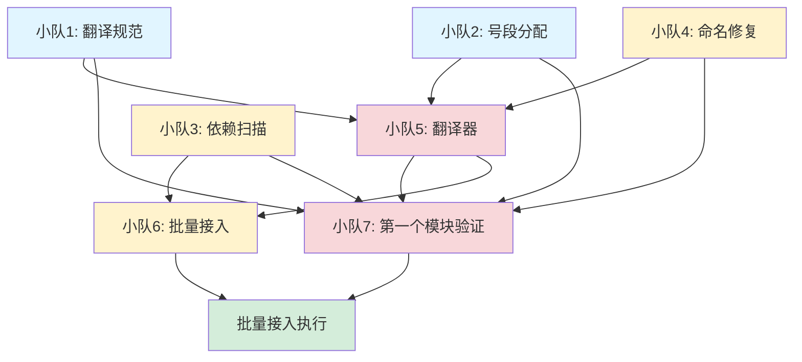

# 老项目接入任务书总览

**更新时间**：2026-10-06  
**状态**：等待认领

---

## 一、任务全景

将老项目（系统工程平台/）翻译成V1契约声明，接入扩展装载机制。

**总体目标**：
1. 制定翻译规范（老项目格式 → V1契约格式）
2. 实现自动化翻译器（机械执行翻译规范）
3. 批量接入所有模块（按依赖顺序）

**关键里程碑**：
- ✅ 稳固标准1达成（门禁全绿 3.6秒）
- 🔄 稳固标准2推进（命名债务 121条 → 0条）
- ⏳ 老项目接入验证（第一个模块）
- ⏳ 批量接入（所有模块）

---

## 二、任务分解（7个任务书）

### 小队1：翻译规范制定 ⚡ P0
**agent**：hermes  
**耗时**：1~2小时  
**依赖**：无  
**产出**：
- `翻译规范.md`
- `示例_知识库模块翻译对照.json`

**任务书**：`01_翻译规范制定.md`

---

### 小队2：号段预留与分配 🔧 P0
**agent**：codex  
**耗时**：30分钟  
**依赖**：无  
**产出**：
- `契约声明/号段图.json`（更新）
- `号段分配表.json`

**任务书**：`02_号段预留与分配.md`

---

### 小队3：依赖关系扫描 🔍 P1
**agent**：zcode  
**耗时**：1小时  
**依赖**：无  
**产出**：
- `老项目依赖图.json`
- `老项目依赖图.md`

**任务书**：`03_依赖关系扫描.md`

---

### 小队4：命名修复规则库 📝 P1
**agent**：hermes  
**耗时**：2小时  
**依赖**：无（可以边接入边补充）  
**产出**：
- `命名修复映射.json`
- `命名修复统计.md`

**任务书**：`04_命名修复规则库.md`

---

### 小队5：翻译器框架实现 🛠️ P0
**agent**：codex  
**耗时**：3小时  
**依赖**：小队1、小队2、小队4  
**产出**：
- `老项目模块翻译.py`
- `翻译器测试.py`
- `使用说明.md`

**任务书**：`05_翻译器框架实现.md`

---

### 小队6：批量接入脚本 🚀 P1
**agent**：codex  
**耗时**：1小时  
**依赖**：小队3、小队5  
**产出**：
- `批量接入.sh`
- `批量接入日志.txt`

**任务书**：`06_批量接入脚本.md`

---

### 小队7：第一个模块接入验证 ✅ P0
**agent**：hermes  
**耗时**：2小时  
**依赖**：小队1~5  
**产出**：
- `契约声明/能力声明/外部_<模块名>.json`
- `第一个模块接入报告.md`

**任务书**：`07_第一个模块接入验证.md`

---

## 三、依赖关系图



**图例**：
- 蓝色：无依赖，可立即开始
- 黄色：低优先级，不阻塞关键路径
- 红色：关键路径，阻塞后续任务
- 绿色：最终目标

---

## 四、执行计划

### 第一阶段：基础建设（并行）
**时间**：第1~2天

**并行任务**：
- 小队1：翻译规范制定
- 小队2：号段预留与分配
- 小队3：依赖关系扫描
- 小队4：命名修复规则库

**里程碑**：4个基础产物完成

---

### 第二阶段：翻译器开发
**时间**：第3天

**串行任务**：
- 小队5：翻译器框架实现（等小队1、2、4完成）

**里程碑**：翻译器能跑

---

### 第三阶段：验证与批量
**时间**：第4~5天

**并行任务**：
- 小队6：批量接入脚本（等小队3、5完成）
- 小队7：第一个模块接入验证（等小队1~5完成）

**里程碑**：
- 第一个模块接入成功
- 批量脚本准备就绪

---

### 第四阶段：批量接入
**时间**：第6天

**触发条件**：
- ✅ 小队7验证通过
- ✅ 命名债务清零（121条 → 0条）

**执行**：
```bash
bash 构建装配/翻译器/批量接入.sh
```

**验收**：
- ✅ 所有模块翻译完成
- ✅ 门禁通过（闸0 < 5秒）
- ✅ 无新增命名债务

---

## 五、风险与预案

### 风险1：翻译器bug导致批量失败
**预案**：先用小队7验证，暴露所有问题后再批量

### 风险2：命名修复规则不完整
**预案**：小队4可边接入边补充，不阻塞其他任务

### 风险3：依赖关系有循环依赖
**预案**：小队3标记循环依赖，人工打破后再接入

### 风险4：号段不够用
**预案**：已改为每模块10000号（原100号），长期扩展充足

---

## 六、认领流程

### 认领任务
1. 打开对应任务书（`01_*.md` ~ `07_*.md`）
2. 在任务书末尾标注：
   ```
   **任务状态**：已认领  
   **agent名**：<你的名字>  
   **开始时间**：<YYYY-MM-DD HH:MM>
   ```
3. 开始工作

### 完成任务
1. 提交产物（文件放到指定位置）
2. 在任务书末尾标注：
   ```
   **完成时间**：<YYYY-MM-DD HH:MM>  
   **实际耗时**：<X小时>  
   **验收状态**：通过/待修正
   ```
3. 通知依赖你的小队

### 任务协调
- 有依赖关系的任务，上游完成后通知下游
- 遇到阻塞问题，及时在任务书里标注

---

## 七、产物清单

### 规范文档
- `构建装配/翻译器/翻译规范.md`
- `构建装配/翻译器/使用说明.md`

### 数据文件
- `契约声明/号段图.json`
- `构建装配/翻译器/号段分配表.json`
- `构建装配/翻译器/老项目依赖图.json`
- `构建装配/翻译器/命名修复映射.json`

### 可执行工具
- `构建装配/翻译器/老项目模块翻译.py`
- `构建装配/翻译器/翻译器测试.py`
- `构建装配/翻译器/批量接入.sh`

### 验证报告
- `构建装配/翻译器/第一个模块接入报告.md`
- `构建装配/翻译器/命名修复统计.md`
- `构建装配/翻译器/老项目依赖图.md`

### 翻译产物
- `契约声明/能力声明/外部_*.json`（所有外部模块的契约）

---

## 八、进度追踪

**使用说明**：
1. **认领任务**：在下表填写 agent名 和 开始时间，状态改为"进行中"
2. **完成任务**：填写 完成时间 和 实际耗时，状态改为"已完成"
3. **同时更新对应任务书**：在任务书末尾追加执行记录（见第六节）

| 任务 | agent | 状态 | 开始时间 | 完成时间 | 耗时 |
|------|-------|------|----------|----------|------|
| 小队1：翻译规范 | zcode-01 | 已完成 | 2026-10-06 | 2026-10-06 | - |
| 小队2：号段分配 | zcode-02 | 已完成（经v1-100355修订：149条真实口径） | 2026-10-06 17:20 | 2026-10-06 | - |
| 小队3：依赖扫描 | zcode-03 | 已完成（采用包级口径v1-100346，149包） | 2026-10-06 | 2026-10-06 | - |
| 小队4：命名修复 | zcode-04 | 已完成 | 2026-10-06 | 2026-10-06 | - |
| 小队5：翻译器 | zcode-05 | 已完成（经v1-100353修复号段表读取bug；收口合并时修复命名修复映射读取bug） | 2026-10-06 | 2026-10-06 | - |
| 小队6：批量脚本 | zcode-06 | 已完成，★待适配包级依赖图字段（见下方待办） | 2026-10-06 | 2026-10-06 | - |
| 小队7：第一验证 | zcode-07 | 已完成（走通流程；号段用脚手架临时值，非正式号段，不影响结论） | 2026-10-06 | 2026-10-06 | - |

**收口说明（2026-10-06）**：以上7个任务书产物分散在13个worktree分支（v1-100342~100356），由收口方统一checkout精确文件拣选落主干，不做分支合并（避免共享文件冲突）。拣选原则：取"最终修订版"而非"最先产出版"（如号段表取v1-100355的149条真实口径，不取v1-100350的80条初版；依赖图取v1-100346的包级口径，不取v1-100342的11层顶层区口径——因为翻译器与号段表都是以"包"为接入单位）。合并后发现翻译器(v1-100353)与命名修复映射(v1-100344)字段形状不兼容（`上下文映射`期望`{候选:[...]}`，真实是直接数组）——已在 `翻译器实现.py::修复名字` 修复，`老项目模块翻译.py --模块 数值计算支持库` 实测跑通（号段1324–1335，与号段分配表一致）。

**示例填写**：
```
| 小队3：依赖扫描 | zcode-03 | 进行中 | 2026-10-06 19:30 | - | - |
```

完成后改为：
```
| 小队3：依赖扫描 | zcode-03 | 已完成 | 2026-10-06 19:30 | 2026-10-06 21:15 | 1.75h |
```

---

**最后更新**：2026-10-06  
**维护责任**：任务状态变更时更新此文件
