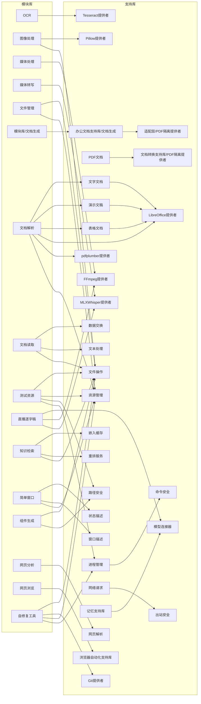

# 老项目模块依赖图（包级）

> **小队3产物** · 生成时间 2026-10-06 · 机器可读件同名 `.json`
> **口径**：模块单位 = **包**（以 `包声明.json` 为标记，共 148 个）；
> 依赖 = `包声明.json` 的 `依赖[].能力`，按「包自身声明的 `能力[].能力id`」精确匹配到归属包；
> 层级 = 最长路径分层（Kahn）。老项目**只读**。

## 一、为什么按「包」而不按顶层目录

1. **翻译器的接入单位是包**：一份 `包声明.json` 翻成一个 V1 扩展目录（见任务书 01 翻译规范）。
2. 老项目有**两套并存结构**：① **包级契约结构**（148 个包，只在 6 个顶层区里）；
   ② **顶层区代码结构**（15 个顶层目录，多数区没有 `包声明.json`）。
3. 本图按包出图（可执行的接入顺序）；顶层源码层那一版见 `腿/v1-100342` 的同名产物，两版互补。

## 二、扫描范围与口径

- 老项目根：`/Users/hekunhua/Documents/Agent/PHP/系统工程平台`
- 单位：包（`包声明.json`）· 排除 `工程缓存/` · `__pycache__/` · `.git/`
- 依赖来源：`包声明.json` 的 `依赖[].能力`（**能力级**声明 —— 一个包可依赖另一个包里的单个能力）
- 层级算法：最长路径分层（Kahn）；环上节点单列

## 三、总览

| 项 | 读数 |
|---|---|
| 包总数 | 148 |
| 依赖声明条数 | 113 |
| 包间依赖边数（去重） | 46 |
| 无依赖包数 | 124 |
| 被依赖包数 | 28 |
| 悬空依赖条数 | 0 |
| **循环依赖分量数** | **0** |
| 最大层级 | 2 |

## 四、依赖关系可视化



> 箭头方向 = 依赖方向：`A --> B` 读作「A 依赖 B」，故 **B 先接入**。

## 五、接入顺序（按层级）

### 第 1 批（0 层，124 包）

本层共 124 包。其中**被别的包依赖**的 23 个必须先接（其余为叶子 / 孤立包，顺序无关，完整清单见 `.json` 的 `模块清单`）：

- `支持库.前端.状态描述`（支持库，2 能力）
- `支持库.前端.窗口描述`（支持库，4 能力）
- `支持库.后端.OCR识别支持库.OCR识别`（支持库，3 能力）
- `支持库.后端.图像处理支持库.图像解码`（支持库，9 能力）
- `支持库.后端.大语言模型支持库.嵌入缓存`（支持库，4 能力）
- `支持库.后端.大语言模型支持库.模型连接器`（支持库，27 能力）
- `支持库.后端.大语言模型支持库.重排服务`（支持库，2 能力）
- `支持库.后端.媒体处理支持库.FFmpeg媒体`（支持库，7 能力）
- `支持库.后端.数据操作支持库.数据交换`（支持库，9 能力）
- `支持库.后端.数据操作支持库.文本处理`（支持库，10 能力）
- `支持库.后端.文件系统支持库.文件操作`（支持库，22 能力）
- `支持库.后端.文档转换支持库.LibreOffice转换`（支持库，2 能力）
- `支持库.后端.文档转换支持库.PDF文本表格`（支持库，2 能力）
- `支持库.后端.文档转换支持库.PDF隔离提供者`（支持库，3 能力）
- `支持库.后端.浏览器自动化支持库`（支持库，7 能力）
- `支持库.后端.版本控制支持库.Git操作`（支持库，14 能力）
- `支持库.后端.系统核心支持库.命令安全`（支持库，1 能力）
- `支持库.后端.系统核心支持库.资源管理`（支持库，22 能力）
- `支持库.后端.系统核心支持库.路径安全`（支持库，3 能力）
- `支持库.后端.网络通信支持库.出站安全`（支持库，1 能力）
- `支持库.后端.网络通信支持库.网页解析`（支持库，2 能力）
- `支持库.后端.转写支持库.转写`（支持库，3 能力）
- `支持库.适配层.PDF隔离提供者`（支持库，3 能力）

### 第 2 批（1 层，20 包）

- `支持库.后端.办公文档支持库.PDF文档`（支持库，1 能力）
- `支持库.后端.办公文档支持库.文字文档`（支持库，1 能力）
- `支持库.后端.办公文档支持库.文档生成`（支持库，7 能力）
- `支持库.后端.办公文档支持库.演示文稿`（支持库，1 能力）
- `支持库.后端.办公文档支持库.表格文档`（支持库，1 能力）
- `支持库.后端.系统核心支持库.进程管理`（支持库，9 能力）
- `支持库.后端.网络通信支持库.请求`（支持库，4 能力）
- `支持库.后端.记忆支持库`（支持库，9 能力）
- `模块库.OCR`（基础模块，3 能力）
- `模块库.图像处理`（基础模块，9 能力）
- `模块库.媒体处理`（基础模块，6 能力）
- `模块库.媒体转写`（功能模块，4 能力）
- `模块库.文件管理`（基础模块，9 能力）
- `模块库.文档读取`（基础模块，4 能力）
- `模块库.直播逐字稿`（功能模块，4 能力）
- `模块库.知识检索`（基础模块，2 能力）
- `模块库.简单窗口`（基础模块，6 能力）
- `模块库.组件生成`（基础模块，1 能力）
- `模块库.网页分析`（基础模块，1 能力）
- `模块库.网页浏览`（基础模块，1 能力）

### 第 3 批（2 层，4 包）

- `模块库.文档生成`（功能模块，1 能力）
- `模块库.文档解析`（功能模块，1 能力）
- `模块库.测试资源`（功能模块，2 能力）
- `模块库.自修复工具`（功能模块，10 能力）

**同一批次内可并行接入**（互不依赖）；**跨批次必须按序**。

## 六、顶层区视图

### 6.1 包级（契约口径）

| 顶层区 | 包数 |
|---|---|
| 支持库 | 111 |
| 模块库 | 19 |
| 平台控制面 | 15 |
| 启动监督器 | 1 |
| 技能库 | 1 |
| 运行核心 | 1 |

跨区依赖（包级）：

- `模块库` → `支持库`

### 6.2 代码级（AST import 实测，旁证）

| 顶层区 | 静态导入的顶层区 |
|---|---|
| . | 公共契约 |
| 公共契约 | 平台控制面 |
| 后端核心 | 公共契约 · 运行核心 |
| 启动监督器 | 公共契约 · 支持库 · 项目适配层 |
| 客户端 | 公共契约 · 后端核心 · 平台控制面 · 开发工具 · 支持库 |
| 平台控制面 | 公共契约 · 支持库 · 运行核心 |
| 开发工具 | 公共契约 · 前端核心 · 后端核心 · 支持库 · 模块库 · 示例项目 · 运行核心 · 项目适配层 |
| 技能库 | 公共契约 |
| 支持库 | 公共契约 · 开发工具 |
| 模块库 | 公共契约 |
| 测试中心 | 公共契约 · 前端核心 · 后端核心 · 启动监督器 · 客户端 · 平台控制面 · 开发工具 · 技能库 · 支持库 · 模块库 · 运行核心 · 项目适配层 |
| 示例项目 | 公共契约 · 前端核心 · 后端核心 · 平台控制面 · 开发工具 · 支持库 · 模块库 · 运行核心 · 项目适配层 |
| 运维脚本 | 公共契约 · 开发工具 |
| 运行核心 | 公共契约 · 后端核心 · 启动监督器 · 支持库 · 模块库 |
| 项目适配层 | 公共契约 · 运行核心 |

★ 代码级图有环（`支持库` ↔ `开发工具`、`运行核心` ↔ `启动监督器` 等），
**包级契约图无环** —— 接入顺序以包级为准（契约级依赖才是接入依据）。

## 七、发现

1. **0 循环依赖**（包级契约图是 DAG；层级 0-2，共 3 层）。
2. 依赖是**能力级**而非包级：113 条依赖声明去重成 46 条包间边。
3. **49 条能力id 被多个包声明** —— 聚合父包重复声明了子域包的能力（如 `系统核心支持库` 与 `系统核心支持库.资源管理`）；
   本图取**最具体**的包（包id 最长）作依赖目标。
4. **名称有重名**：13 对 `*提供者`（后端子域包 vs 适配层包）+ `能力目录` 两处 ⇒ 接入身份用 `包id`，不用 `名称`。
5. **悬空依赖 0 条**（无）。
6. `模块库` 的 19 个包**互不依赖**，全部直接依赖 `支持库` ⇒ 模块可并行接入。

## 八、复现（算法口径）

生成器本体**未落盘** —— 闸⑤（命名登记）要求每个形参 / 局部绑定名先在库 `命名登记` 里为「合格」，
而本算法约 80 个局部名多为禁止形状（单汉字 / 西文单字母），登记它们要改二进制规则库
`开发工具/信息核心/信息核心.db`（合并期风险高）⇒ 本轮只落数据件。**算法在本节写全，可照此重实现**：

1. **收集包**：走老项目树收 `包声明.json`（剪枝掉 `工程缓存/` · `__pycache__/` · `.git/`），得 148 个包。
2. **解析依赖**：建「能力id → 声明它的包」索引（取每个包的 `能力[].能力id`）；
   对每条 `依赖[].能力` 精确查索引；**多候选取包id 最长者**（聚合父包重复声明子域能力）；
   查不到 ⇒ 记「悬空」。
3. **分层**：Kahn 最长路径 —— `层级(包) = 1 + max(层级(直接依赖))`，无依赖 = 0；
   沿「依赖 → 依赖者」传播（勿反向）。
4. **找环**：Tarjan 强连通分量（大小 > 1 或自环即记）。
5. **落盘**：遍历一律按 `包id` 排序 ⇒ 逐字节可重复；不含时间戳 / 绝对路径 / 随机数。

校验读数（与 `.json` 的 `统计` 段对得上）：

```sh
python3 -c "import json;d=json.load(open('构建装配/翻译器/老项目依赖图.json'));print(d['统计'])"
```


## 九、执行记录（认领）

| 项 | 值 |
|---|---|
| 开工 | v1-100346 |
| agent | zcode-03 |
| 开始 | 2026-10-06 17:31 |
| 口径 | 包级（148 包） |
| 状态 | 见 `.json` 统计段与 v1_gate 读数 |
